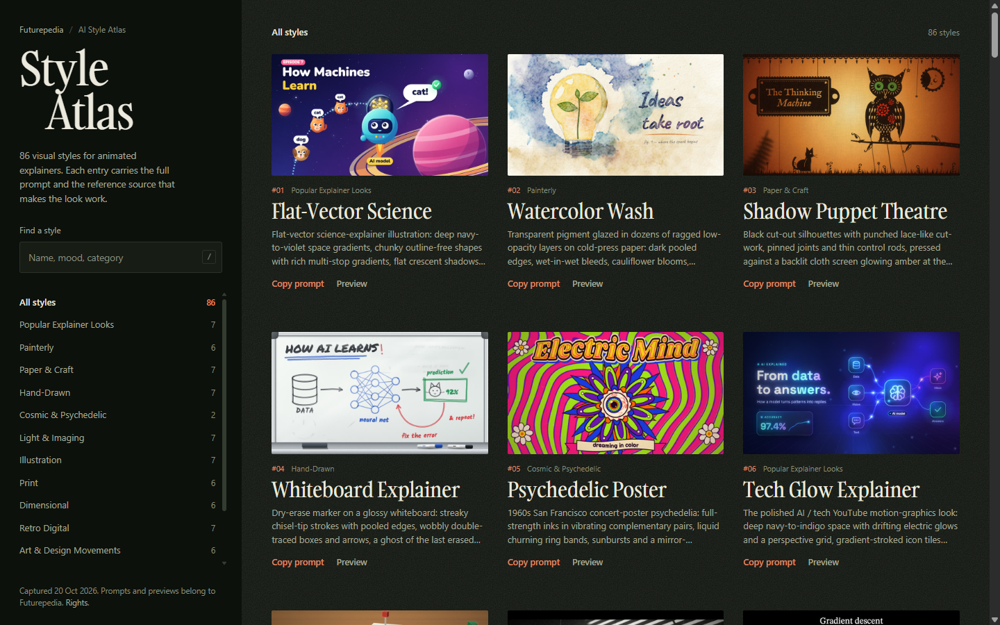

# AI Style Atlas prompts

86 prompts for making animated explainers in a specific visual style. Every prompt ships with the complete source code of a reference animation in that style, plus a small sound-effects kit, so a coding assistant can rebuild the look around your own topic.

This is an unofficial archive of the public [AI Style Atlas](https://www.futurepedia.io/resources/ai-style-atlas/view) by Futurepedia, captured on 20 October 2026. The prompts and preview media belong to Futurepedia. See [NOTICE.md](NOTICE.md).



## What is in here

- `prompts/` : one Markdown file per style, containing the exact prompt text
- [INDEX.md](INDEX.md) : all 86 styles grouped by category, with links
- `data/styles.json` : metadata, categories, prompt sizes and preview media URLs
- `index.html` : a static viewer with search, category filters, prompt preview and copy buttons
- `scripts/fetch.mjs` : rebuilds the prompt files and manifest from the public API
- `scripts/serve.mjs` : a zero-dependency local server for the viewer

The archive is 7.3 MB. Prompts run from about 66 KB to 121 KB each because the reference animation source is included in full.

## Use a prompt

1. Open [INDEX.md](INDEX.md) or run the viewer.
2. Copy the prompt for a style.
3. Paste it into Claude or another coding assistant that can write and preview a self-contained HTML file.
4. Replace the `MY CONTENT` block with your topic or script. If you leave it alone, the prompt asks you for it.
5. The prompt asks for a visual storyboard first. Check it, approve it, and the assistant builds the animation from that storyboard.

The prompts are written for an assistant that can show an HTML artifact, not for an image generator. They produce a 1280x720 canvas animation with sound, controls, a deterministic timeline, and a `window.seek()` hook for frame-by-frame rendering.

## Run the viewer

The viewer is a static page, but it loads JSON and Markdown files, so it needs a local server. From this folder:

```bash
npm run serve
```

Then open <http://localhost:4173>. Opening `index.html` directly with `file://` will not work.

The viewer is also published at <https://vinay10000.github.io/ai-style-atlas/>.

## Refresh the archive

```bash
node scripts/fetch.mjs
```

This uses the site's default prompt options: storyboard on, voiceover off. It writes the prompt files, `data/styles.json` and `INDEX.md`. No dependencies are needed, only Node 18 or newer.

To get the voiceover variant, set `voiceover: true` in `PROMPT_OPTIONS` at the top of the script. That version asks for an SRT or word-level timestamps and times the animation to the voiceover.

## Repository layout

```text
.
├── INDEX.md
├── README.md
├── NOTICE.md
├── LICENSE
├── index.html
├── assets/
│   ├── favicon.svg
│   ├── screenshot.png
│   ├── viewer.css
│   └── viewer.js
├── data/
│   └── styles.json
├── prompts/
│   ├── 001-flat-vector-science.md
│   └── ...
└── scripts/
    ├── fetch.mjs
    └── serve.mjs
```

## What a prompt contains

Each prompt is a set of working instructions, not a one-line style tag. It includes:

- a short description of the medium, palette and finishing details
- the complete reference animation source, with its drawing and texture functions
- a sound-effects kit
- rules for staying inside the style while changing the subject
- layout, legibility and performance limits
- a storyboard-first step, so you can approve the beats before the build
- instructions for deterministic frames, so the animation can be rendered to video

The prompts assume the assistant will write a new `explainer()` function for your topic. They tell it not to copy the reference's robots, cats, rings and other props unless those props fit your subject.

## Notes

- Preview videos and posters are linked from Futurepedia's CDN. They are not stored in this repository.
- Two prompts use the atlas's internal style name on the first line: #26 Editorial Chart says "Artificial intelligence" and #48 Transit Map says "Data Line". The style card and reference source in each file match the display name. The text is kept exactly as the API returns it.
- The source API can change without notice. `scripts/fetch.mjs` checks the expected count and fails loudly if the shape changes.
- Some styles are close to existing artists, studios or brands. The descriptions name movements and tools, not licenses. Check the rights before using a look in commercial work.

## Credits and rights

The style descriptions, prompts, preview images and videos come from Futurepedia's AI Style Atlas. They are included here for personal reference and study. They are not covered by the MIT license on the code. If you republish them, credit Futurepedia and check their terms.

The fetch script, server and viewer code are MIT licensed. See [LICENSE](LICENSE).

This project is not affiliated with Futurepedia.
